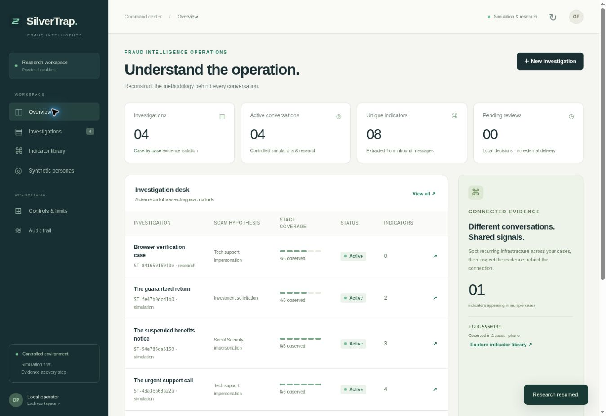

# SilverTrap

**Reconstruct the operation behind the conversation.**

SilverTrap is a private, simulation-first fraud research application. Three fictional older-adult personas participate in controlled conversations while a separate analyst pipeline records manipulation tactics, requested information, payment mechanisms, and the sequence of a suspected scam. Every finding links to an exact source quote. Missing stages remain unknown.

This is a working v0.1 application, including a Python backend, persistent case database, authenticated browser command center, attack-chain explorer, synthetic scenarios, evidence exports, and regression tests. It runs with **Python 3.11+ and no third-party runtime dependencies**. No API key, paid model, Node build, Redis server, or database service is required.



## Start on Windows

Download or clone this private repository, open PowerShell in its folder, and run:

```powershell
py -3 -m silvertrap serve --seed
```

Open **http://127.0.0.1:8787** and paste the operator access code printed in that terminal. Keep the terminal open while using the dashboard. `start.ps1` provides the same launch flow and keeps errors visible. Python must be version 3.11 or newer.

On macOS or Linux:

```sh
python3 -m silvertrap serve --seed
```

`--seed` adds three **fictional simulation cases only when the database is empty**. Your work persists in `data/silvertrap.sqlite3`; restart with the same data directory to resume it. This folder, its access code, exports, and backups are excluded from Git.

## What you can do

- **Run nine synthetic scenarios:** tech support, Social Security, Medicare, romance, investment, government, grandparent emergency, a benign reminder, and a prompt-injection test.
- **Advance one exchange or a full scenario.** Each persona uses independent case history and stage-aware questions without repeating previously used templates.
- **Explore seven scam stages.** Select a stage, inspect observed phrases, and jump to the originating message. View the chronological findings alongside the fixed stage reference map.
- **Separate observation from inference.** Classification and financial objectives are hypotheses; unobserved phases and unknown ownership stay explicit.
- **Correlate indicators across cases.** Extract URLs, domains, email addresses, US-format phone numbers, and cryptocurrency-address candidates. Shared infrastructure is a lead, not proof of a network.
- **Create manual research cases or import JSON transcripts.** Only inbound messages feed the intelligence engine. Imports are read-only after creation.
- **Review persona drafts locally.** In simulations an approved draft can enter the fictional transcript. In research cases approval records a review decision; it does not send a message.
- **Pause or close cases and apply a persistent emergency stop.** Closed cases stay read-only. Emergency stop invalidates pending drafts and blocks intake, simulation, approvals, and model calls.
- **Export Markdown reports and JSON evidence packages.** Check source offsets, message chains, and a whole-case checksum; make consistent SQLite backups through the CLI.
- **Optionally request a local model second opinion.** No model is called by default. Ollama hypotheses must pass structural and literal-evidence validation and remain labeled as inferences.

## Resource-friendly architecture

| Component | v0.1 implementation | Reason |
| --- | --- | --- |
| Orchestrator | Python standard library | One small process; straightforward deployment |
| Persistent storage | SQLite with WAL and transactions | No separate database or queue services |
| Command center | HTML, CSS, vanilla JavaScript | No frontend dependency tree or build step |
| Analyst roles | Incremental deterministic modules | No seven-model-call cascade per message |
| Optional local analysis | Ollama, one bounded call | Explicit opt-in; no paid provider installed |
| Inbound integration seam | HMAC-signed JSON intake | Disabled unless configured; no outbound transport |
| Verification | `unittest`, synthetic evaluation | Runs offline with no test dependencies |

The seven roles are Persona Agent, Behavioral Analyst, Scam Classifier, Financial Analyst, Intelligence Extractor, Reconstruction Agent, and Safety Supervisor. They are specialized code paths sharing a small process, not seven independent LLM instances. The optional model supplies additional hypotheses; it cannot control the persona, execute tools, change controls, or send messages.

Default limits: **200 cases, 80 messages per case, 8 KiB per message, 128 KiB stored text per case, 200 MiB database write budget, four model attempts per case, and one concurrent model request.** These are explicit constants in `silvertrap/config.py`. The HTTP server permits at most 16 concurrent requests. Model responses are capped at 64 KiB, requested output at 1,000 tokens, and the HTTP request timeout at 25 seconds; cancellation of model computation is not guaranteed by a client timeout.

## Verify the build

```sh
python -m unittest discover -s tests -v
python scripts/evaluate.py
```

Evaluation uses nine fixtures designed alongside the rules. Passing it demonstrates regression consistency, **not independent real-world accuracy**. The tests cover source provenance, case isolation, idempotency, resource limits, immutable closed cases, redaction, prompt injection, stop persistence, export tampering, local-model validation, signed intake, authentication, and concurrent simulation requests. CI repeats the offline checks on Python 3.11, 3.12, and 3.13.

## CLI

```sh
python -m silvertrap --help
python -m silvertrap simulate tech-support
python -m silvertrap export ST-your-case-id exports/case.json
python -m silvertrap verify exports/case.json
python -m silvertrap backup backups/silvertrap.sqlite3
python -m silvertrap --data-dir ./research-data serve --seed
```

An evidence package includes the case, messages, findings, indicators, reconstruction, and a manifest. Checksums detect changes relative to a retained export; they do not establish sender authenticity or prevent someone with the full file from recalculating hashes. Keep an independent copy of the manifest. Message and indicator offsets are zero-based **Unicode code-point indices**, end exclusive, in the stored redacted text.

## Optional local intelligence

If you already have Ollama running locally with a model installed, set its exact local model name before starting SilverTrap:

```powershell
$env:SILVERTRAP_OLLAMA_MODEL = "your-installed-local-model"
py -3 -m silvertrap serve
```

```sh
SILVERTRAP_OLLAMA_MODEL=your-installed-local-model python3 -m silvertrap serve
```

The **Local model second opinion** button sends a bounded recent evidence window to the fixed loopback endpoint `http://127.0.0.1:11434/api/chat`. No arbitrary model URL is accepted, redirects and environment proxies are disabled, and the request grants no tools. The application does not download models. Run a local model rather than a cloud-routed model if your requirement is offline processing. Model RAM and compute are additional to the core app's usage.

Responses are cached by case, model, and transcript hash. Attempts are reserved before calling the provider; failures consume the attempt and are not automatically retried. Evidence changes or an emergency stop while inference runs cause its results to be discarded. Local-model hypotheses require human interpretation even when their quotes are valid. See the [Ollama chat contract](https://docs.ollama.com/api/chat) and [structured output documentation](https://docs.ollama.com/capabilities/structured-outputs).

## Transcript imports

Use **New investigation → Import transcript**:

```json
{
  "messages": [
    {"role": "inbound", "text": "This is Microsoft support. Respond immediately."},
    {"role": "persona", "text": "Could you explain what this concerns?"},
    {"role": "inbound", "text": "Buy gift cards and send me the gift card codes."}
  ]
}
```

The import role `persona` means the non-inbound side of the transcript; imported text is supplied evidence, not proof that SilverTrap generated that message. Do not import real credentials. Best-effort redaction removes common SSN, Luhn-valid card, and explicit secret-value patterns before storage. It does not anonymize every name, phone number, or other personal detail. The original message is not retained; its SHA-256 fingerprint is retained with the redacted record.

## Hybrid deployment path

The simulation-first foundation is implemented. A disabled-by-default, signed intake endpoint is available for a dedicated inbound adapter. It only accepts messages into an existing controlled research case. It does not connect to a mailbox, phone carrier, victim account, or outbound messaging service. [The API guide](docs/API.md) defines signatures, timestamp expiry, and replay protection.

Production inbound operation still needs a provider-specific adapter, channel authorization, TLS and operator identity management, durable delivery semantics, independent evaluation, retention policy, and operational review. Autonomous live replies, voice calls, attachments, browser execution, payments, and reporting to third parties are not implemented. The system does not retaliate, threaten, provoke, or access a sender's systems.

## Docker option

```sh
docker compose up --build
docker compose logs silvertrap
```

The compose service binds only to the host loopback address, runs as a non-root user, keeps data in a named volume, and caps the application at 256 MiB and one CPU. Copy the access code from its logs. These container limits exclude any separately running local model. Docker execution is an optional packaging path; the standard-library app is the primary tested runtime.

## Further technical detail

- [Architecture and data contracts](docs/ARCHITECTURE.md)
- [API and signed intake](docs/API.md)
- [Security and operating boundaries](docs/SECURITY.md)
- [Evaluation and next milestones](docs/ROADMAP.md)

This repository is intended to stay private. Runtime evidence, tokens, logs, and personal data belong outside source control.
